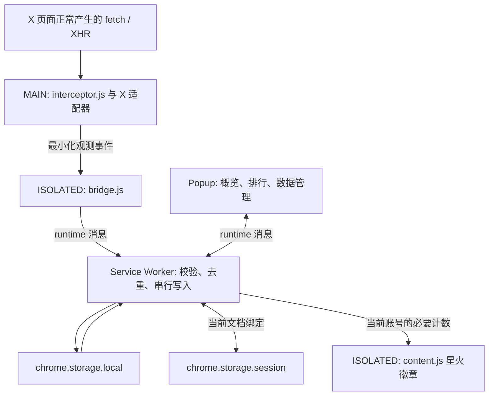

# SparkLink Product and Technical Specification

| Field | Value |
| --- | --- |
| Product | SparkLink - 星火链 |
| Slogan | 我不会错过你的每一次发声 |
| Document version | 1.2.0 |
| Target extension version | 1.0.0 |
| Review date | 2026-11-16（Asia/Shanghai） |
| Target platform | Google Chrome / Microsoft Edge，Chromium Manifest V3 |
| Technical baseline | Vanilla JavaScript（ES2022）、HTML、CSS、Chrome Extension APIs |
| Status | 本地 MVP 有条件可行，登录后的 X 页面兼容性待实机验证 |

本文整合原 X-Pulse v1.0.0 规格与 SparkLink 品牌方案，作为后续实现和验收依据。本次交付为规格文档，尚未实现插件，也未在登录后的 X 页面执行验证。

## 1. Feasibility Review

**本地 MVP 有条件可行。** 近 30 天计数、徽章和排行榜可从本地回复记录生成。采集能否成立，取决于 Chrome 和 Edge 上的真实页面能否在用户正常操作时提供当前登录账号、成功回复和直接回复对象的证据。第 12.1 节列出了逐项验收条件。

| Original assumption | Finding | Required decision |
| --- | --- | --- |
| 自动统计完整的近 30 天互动 | 本机可观测的网页活动和用户导入的备份都可能只覆盖部分历史 | 按“近 30 天已记录的主动回复（含导入）”展示，同一条回复只计一次 |
| 监听发送请求即增加次数 | 请求可能失败、被限流，或 HTTP 成功但业务返回错误 | 解析成功响应，确认新回复 ID、作者和回复关系后才计数 |
| 从回复弹窗匹配对象 | 内嵌回复、弹窗卸载和多对象提及会造成错配 | 优先使用响应里的直接回复对象 ID，或精确关联父帖作者 |
| 以 handle 为主键 | 用户可能改名，旧 handle 也可能被其他账号使用 | 使用稳定用户 ID；handle 仅作可更新的展示信息 |
| 分开保存 timestamps 和 tweetIds | 清理和去重容易脱节，实时与历史路径可能重复计数 | 以回复 ID 为键保存包含时间和目标用户的完整事件 |
| 不需要后台，多个页面直接写 storage | 跨标签页的读、改、写可能互相覆盖 | 增加按需运行的 Service Worker，统一串行写入 |
| MAIN 注入不受 CSP 影响 | MAIN 与页面共享环境，页面 CSP 仍适用 | 使用声明式注入和打包代码，不使用 eval 或远程脚本 |
| 随机消息标记可以防伪造 | 同一页面脚本能接触 MAIN 和通信通道 | 校验和限流只能缩小攻击面，不能证明观测真实性 |
| 读取 twid 即可完成账号隔离 | Cookie 可读性、格式和当前页面同步情况均未验证 | 首版不依赖 Cookie，账号识别作为必须验证的独立能力 |
| 修改 toString 可实现防检测、零风险 | 函数包装仍可能被识别，也不能证明符合平台规则 | 移除伪装和零风险承诺；坚持不自动操作、不新增数据请求 |
| 原稿 manifest 可直接使用 | 原稿部分 URL 混入 Markdown 链接格式，不能作为匹配模式 | 使用第 11 节给出的纯字符串配置 |

Chrome 官方说明了 MAIN 与页面共享环境以及页面 CSP 的适用范围，不能把 MAIN 当作安全沙盒或 CSP 绕过机制。参见 [Manifest content scripts](https://developer.chrome.com/docs/extensions/reference/manifest/content-scripts) 与 [Content scripts](https://developer.chrome.com/docs/extensions/develop/concepts/content-scripts)。

## 2. Brand and Product Scope

### 2.1 Brand Identity

- 扩展名称：`SparkLink - 星火链`。
- 简称：`SparkLink`。
- Slogan：`我不会错过你的每一次发声`。
- 定位：帮助用户识别自己近期经常主动回复的人。
- 主图标：深空蓝或黑色背景，中心为微光至亮橙色的星火与链环图形；提供 16、32、48、128 像素 PNG。
- Popup 主标题使用 `SparkLink`，下方放置 slogan；副标题可使用 `#71767B`，最终需检查实际主题下的文字对比度。
- 首版界面使用简体中文，双语名称用于品牌展示；自动切换界面语言留作后续功能。

### 2.2 MVP Scope

首版包含：

1. 被动捕获当前登录账号成功发送的网页端回复。
2. 用户自行浏览自己“回复”时间线时，补充其中可识别的近 30 天历史回复。
3. 按直接回复对象计算数量，在受支持的帖子和评论作者信息旁展示星火徽章。
4. 按账号展示概览和 Top 20 排行榜，提供浏览器级采集开关、过期清理、按账号或全部清空以及 JSON 导入导出。
5. 对账号无法确认、接口不兼容和存储失败提供可理解的状态提示。

计数方向为“我 → 对方”。不统计对方回复我、点赞、转发、引用、私信、关注或纯提及；回复自己的帖子也不计入。普通发帖不属于回复。Slogan 是品牌表达，首版不提供对方发帖通知，也不承诺完整捕获其每一次发声。

### 2.3 Observation Coverage

Popup 的概览标题和覆盖说明使用以下文案。

> 近 30 天已记录的主动回复（含导入）
>
> 来源包括本机网页活动和导入的备份，历史记录可能不完整。

概览、排行和徽章都按当前账号窗口内的唯一回复计数。“最近回复时间”取这些记录中最大的 `createdAt`，空集合显示“尚无已记录回复”。备份里的时间可能来自另一台设备。页面缓存、接口变更和未加载的历史都会影响覆盖程度，首版不计算本机观测时长或历史完成百分比。

插件不自动滚动、不模拟点击、不自动翻页、不主动调用 X 内部或公开 API。用户主动点击主页链接所产生的正常浏览不属于插件后台采集。

跨设备自动同步、安装前完整历史或双向互动统计，需要另行设计数据来源与授权方案。

## 3. Counting Rules

### 3.1 Event Definition

一个可计数事件必须同时具备：

- `actorUserId`：发送回复的当前账号稳定 ID。
- `replyTweetId`：已成功创建的回复 ID。
- `parentTweetId`：被直接回复的父帖 ID。
- `targetUserId`：父帖作者稳定 ID，且不等于 `actorUserId`。
- `createdAt`：回复在服务端的创建时间，转换为毫秒 Unix 时间戳。
- `observedAt` 记录来源端首次观测到该回复的毫秒时间戳，导入时保留原值。
- `source` 记录原始来源。实时捕获为 `live`，浏览回复页补录为 `history`，备份中只知道来自导入的记录可为 `import`。单凭此字段无法确定采集设备。

所有用户和帖子 ID 均保存为十进制字符串，不转换为 JavaScript `Number`。不能以同一秒、请求 ID、父帖 ID或文本内容替代回复 ID 去重。

### 3.2 Rolling Window and Deduplication

```text
WINDOW_MS = 30 * 24 * 60 * 60 * 1000 = 2592000000
cutoff = now - WINDOW_MS
eligible = cutoff <= createdAt <= now
deduplicationKey = actorUserId + ":" + replyTweetId
count(actor, target, now) = 符合时间窗口且直接目标为 target 的唯一回复数
```

这是连续 30 × 24 小时窗口，不是自然月，也不按本地日期零点切分。计数使用 `createdAt`，不能使用历史数据被读到的时间。未来时间、无效时间或缺失创建时间的记录不计入；发现明显系统时钟问题时提示检查设备时间，不通过伪造时间修补数据。

实时捕获、历史回溯、重试和重复导入共用同一去重键。键相同且父帖、目标和创建时间相符时保留已有事件。任一字段冲突时保留原记录并报告冲突。两次成功回复同一父帖，只要回复 ID 不同，应计为两次。

X 当前将回复列为不可编辑类型。普通回复凭自身 ID 去重，缺少编辑历史字段也可正常计数。多版本回复仅作前向兼容测试。若将来实际返回多个版本且关系不明，仅跳过该实体并报告适配异常，待有样本后再定义归并规则。[X 编辑说明](https://help.x.com/en/using-x/edit-post)

统计含义是“已记录的成功回复（含导入）”。首版按原创建时间到期，不主动查询后续删除状态。

### 3.3 Stable Identity

X 公开数据字典区分帖子作者 ID、直接回复用户 ID和可变的用户名。此处只采用其身份与回复关系语义；公开 API 字段不能证明网页内部 GraphQL 使用同一结构。参见 [X API data dictionary](https://docs.x.com/x-api/fundamentals/data-dictionary)。

`handle`、`displayName` 仅用于展示，可以随正常观测更新。同一个用户改名不拆分历史；不同用户使用过同一 handle 不合并历史。

## 4. Runtime Architecture



### 4.1 Responsibilities

| Component | Responsibility | Boundary |
| --- | --- | --- |
| `interceptor.js` | 封装页面网络入口，读取命中白名单的数据副本 | 不访问扩展存储，不执行后台请求 |
| `x-adapter.js` | 识别受支持的操作和结果结构，生成规范化事件及临时 ID 映射 | 私有接口适配集中于此，未知结构跳过 |
| `bridge.js` | 尽早安装消息接收器，校验载荷，转发观测并处理确认 | 不允许页面调用任意扩展能力 |
| `content.js` | 识别作者节点、查询必要计数、增量渲染与移除徽章 | 不直接修改持久化状态 |
| `background.js` | 管理账号绑定、消息权限、初始化、全局写入队列及状态通知 | 所有持久化修改的唯一入口 |
| `storage.js` / `metrics.js` / `schema.js` | 存储模型、纯计数逻辑、导入与消息校验 | 不依赖 X DOM |
| Popup | 呈现当前账号数据和用户主动执行的数据管理操作 | 不直接进行读改写 |

`bridge.js` 与 MAIN 脚本均在 `document_start` 注入；DOM 渲染脚本在 `document_idle` 初始化。使用就绪握手和有界重试处理初始化时序，不假设不同执行世界之间绝对不会丢失早期消息。

Service Worker 按事件唤醒。每次启动先读取持久化状态，按第 6.1 节恢复文档绑定，再处理本次消息。等待初始化期间保留该消息及其响应通道，清理按第 7.3 节随使用触发。[Chrome 后台生命周期](https://developer.chrome.com/docs/extensions/develop/concepts/service-workers/lifecycle)

### 4.2 Initial Activation

首次安装后 `settings.collectionEnabled` 为 `false`，`settings.captureSessionId` 为 `null`。Popup 说明“在此设备记录主动回复的对象、次数和时间，用于徽章和排行”。用户点击“开启本地统计”时，后台在同一次写入中打开开关，并用本次提交的 `revision` 作为新的 `captureSessionId`。该开关作用于本浏览器的采集。

页面先同步开关。暂停或状态未同步时不读取采集载荷。启用后先取得最小的 viewer 身份信息，绑定完成才解析回复。暂停命令与事件写入共用后台队列，提交时关闭开关并清除 `captureSessionId`。后台随即拒收旧会话事件，并通知页面停止插件自己的读取、清除待处理项。休眠页面恢复时先重新同步。再次开启只接收新会话发起的请求，已有记录仍可在 Popup 查看和导出。

## 5. Data Acquisition

### 5.1 Compatibility Adapter

原稿中的 `CreateTweet`、`UserTweetsAndReplies`、`variables.reply.in_reply_to_tweet_id`、`legacy.in_reply_to_user_id_str` 等仅作为适配候选，不是已验证的当前网页协议。

开发开始时，必须从用户正常操作产生的数据中确认实际请求入口、成功结果、登录身份来源、目标 ID 与分页结构；仅保留脱敏测试样本。动态 GraphQL 查询哈希不写死，操作名、来源、方法和结果结构仍需白名单校验。

首页、帖子详情和个人时间线响应如用于建立作者映射，也必须逐项列入已验证的白名单。不能以“包含 tweet 字样”或递归遍历任意 JSON 作为通用采集策略。

必填字段缺失、含义未知或互相矛盾时，仅跳过受影响的实体，标记“部分数据暂无法识别”。同页其余证据完整的回复照常处理。保留未知状态，避免把缺值转换成 `false`、零次数或旧账号。更名等已确认的资料变化按稳定用户 ID 更新，同时移除旧 handle 的反向映射。

### 5.2 Live Replies

处理流程：

1. 已开启并绑定的页面命中受支持的发帖操作时，暂存父帖 ID、请求关联 ID 和第 6.2 节规定的请求发起时绑定信息。
2. 原始请求正常发送；插件不修改方法、参数、请求头、正文或认证信息。
3. 收到响应时先核对请求原有的采集会话和绑定，仍然有效才读取副本。同时检查 HTTP 成功且业务结果确实包含成功创建的回复实体。
4. 从创建结果提取回复 ID、作者和服务端创建时间，确认回复关系与请求一致。
5. 优先使用回复实体中的直接目标用户 ID；缺失时，使用与 `parentTweetId` 精确匹配的已观测父帖作者 ID。
6. 作者必须与请求发起时绑定的当前账号一致；目标必须明确且非自己，才向后台提交事件。
7. 缺少目标等必要信息的已成功回复，可在内存中等待后续正常浏览补齐。待解析队列最多 1,000 条、保留 10 分钟；超限或超时释放并显示观测不完整状态，不持久化半成品计数。

回复弹窗和点击前的卡片信息只能作为带父帖 ID 的辅助上下文，不能从任意 `@handle` 或“正在回复”文本推断目标。一个回复只计给直接父帖作者，不给被提及的所有人各加一次。

网络错误、取消、429、5xx、业务拒绝、无回复实体和结构未知均不得产生计数。服务端可能实际成功但本机未收到可识别结果时允许漏记，后续可由被动历史观测补齐。

### 5.3 Passive History

- 仅在已确认当前账号、且用户自行打开该账号回复时间线时启用历史补录。
- 检查时间线归属，并逐条验证回复作者等于当前账号；浏览别人的回复页不能改变当前账号身份。
- 按经过验证的时间线结构提取回复实体，不把引用内嵌帖、被转发对象、对话上下文中的他人帖子算成自己的回复。
- 满足第 3 节完整事件条件的记录才入库；过期记录忽略，与实时路径共用去重逻辑。
- 历史请求也冻结发起时的绑定。每页只合并实际读到的有效事件。中断、空页、未到底和到达末页都不能作为删除本地有效回复的依据。已知回复的父帖、作者归属或创建时间发生冲突时保留已提交记录并报告冲突。
- 不发起额外请求获取父帖、用户资料、下一页或未加载的历史。
- 扫到较早时间的某条帖子，不代表这一区间的记录完整，也不代表所有分页都已读到。

历史路径失败时，实时路径可继续工作，并分别显示两者状态。实时路径也无法验证时，不能将插件显示为正常统计中。

### 5.4 Network Semantics and Resource Bounds

网络封装必须优先保证 X 正常工作：

- 只安装一次，保留原始方法引用，正确传递 `this`、原参数、同步异常、返回值和取消语义。
- `fetch` 立即返回原始 Promise；观察响应的副作用链单独处理并捕获错误，不等待解析或存储，也不吞掉原请求异常。
- 不消费原始 `Request` / `Response` 的 body。只有安全可复制的白名单请求才读副本；不支持的流式或已消费正文直接跳过。
- XHR 使用 `open` / `send` 元数据与附加事件监听器，正确处理对象复用及 `responseType`，不覆盖网站的 `onload` 等属性。
- 不修改 `Function.prototype.toString`，不伪造“原生函数”特征；不把保持 `name`、`length` 当作反检测保证。
- 只解析相关 JSON，默认最多同时处理 4 个响应副本。请求正文读取上限 256 KiB，响应副本读取上限 2 MiB；2 秒内未完成则放弃该副本。上限为初始工程预算，需由样本验证。
- 使用有界读取并取消插件自己的读取分支，避免对未知体积响应直接调用无界的 `clone().text()`；不能取消网站的原始读取。

响应副本并非没有内存成本，较慢分支可能产生额外缓冲。参见 [Response.clone()](https://developer.mozilla.org/en-US/docs/Web/API/Response/clone)。页面 Worker 内部的网络、页面预先保存的入口和未来新增传输方式可能不经过本封装，不承诺全部捕获。

## 6. Account Isolation and Messaging

### 6.1 Viewer Binding

1. **文档报到。** 未绑定的 ISOLATED 脚本可以发送 `HELLO`。后台核对浏览器提供的扩展 ID、`sender.tab.id`、顶层 `frameId === 0`、`documentId` 和允许的 X 来源。通过后只返回采集开关、当前采集会话及是否需要绑定。业务载荷中的同名字段不能替代浏览器元数据。[Chrome MessageSender](https://developer.chrome.com/docs/extensions/reference/api/runtime#type-MessageSender)
2. **确认当前账号。** 开启采集后，脚本从明确表示当前登录用户（viewer）的页面初始状态或自然产生的响应提取 `actorUserId`，必要时与账号入口交叉核对。作者、主页路径和 Popup 的选择都不能单独作为身份依据。整个识别路径不读取 `document.cookie`、认证请求头、Bearer 或 CSRF Token。证据不足时保持未绑定，Popup 提示“无法确认当前账号，请刷新 X 页面”。
3. **建立绑定。** 文档通过 `BIND_VIEWER` 提交当前会话和最小 viewer 证据。后台在队列中核对开关、会话和发送方，为该文档与账号分配 `bindingId`。首次建立账号命名空间按第 7.1 节分配 `accountGeneration`。后台在 `chrome.storage.session` 登记浏览器文档标识、`bindingId`、`actorUserId`、`captureSessionId`、`collectionGeneration` 和 `accountGeneration` 后才确认绑定。同一文档、身份及版本重复握手应返回同一有效绑定。
4. **后台唤醒。** Worker 重启后先从 `storage.local` 读取控制状态，再按本次发送方查 `storage.session`。文档、绑定和对应的账号、全局清空、采集会话标识均匹配时沿用原绑定，等待确认的回复可按原标识重试。记录缺失或失效时返回 `BIND_REQUIRED`，脚本重新执行握手，新绑定仅用于之后发起的请求。会话存储可跨 Worker 休眠保留，浏览器重启、扩展停用、重载或更新后需要重新绑定。[Chrome Storage API](https://developer.chrome.com/docs/extensions/reference/api/storage)
5. **切换或退出。** 每个标签页只接受当前活动顶层文档。文档更换、账号切换或身份冲突时立即撤销旧绑定和徽章，释放待解析数据，按顺序重新确认身份。即使同一文档从 A 切到 B 再切回 A，也要获得新的 `bindingId`。撤销只对指定的旧 `bindingId` 生效，页面和后台均忽略上一次识别流程迟到的结果。标签页关闭时释放其会话记录。

Popup 优先展示活动 X 标签页已确认的账号，也可选择已保存账号查看或清空。后台以用户确认时的账号 ID 为单账号管理操作的目标。导出范围始终为全部已保存账号。

### 6.2 Bridge Contract

MAIN → ISOLATED 只传递观测所需字段，不传整个响应、正文、请求头、Cookie 或任意 URL。

ISOLATED 检查 `event.source === window`、`event.origin === location.origin`、协议版本、消息类型、ID格式、字段长度、时间值和数组规模。`postMessage` 使用准确的 `targetOrigin`，不使用 `*`。

握手标记或随机 nonce 用于关联会话和排除无关消息，**不是认证凭据**。同页面脚本仍可能构造合法形状的假观测；在不引入可信数据来源的前提下，无法完全阻止这类统计污染。该数据只用于个人提示，不作为审计或安全判断依据。

实时和历史请求在**发起时**固定文档的 `bindingId`、`actorUserId`、`captureSessionId`、全局 `collectionGeneration` 和该账号的 `accountGeneration`。响应、延迟补齐、组批和重试沿用这组值，一个批次只含同一绑定的事件。后台在写入队列内重新核对浏览器发送方、会话绑定和持久化版本。失效的批次直接结束，不得换用新版本重新提交。上述标识用于关联，权限仍由后台判定。

每文档的观测批次最多 100 条，待确认事件最多 128 条、保留 60 秒。临时通信失败最多重试 3 次，超限提示部分观测遗漏。大批历史数据拆批提交。

| Sender | Allowed operations |
| --- | --- |
| 来源已核验、尚未绑定的 X 顶层 Content Script | `HELLO`，开启采集后可 `BIND_VIEWER`。此阶段不能提交回复或读取任何账号的计数 |
| 已绑定的 X 顶层 Content Script | 提交该账号的观测，查询必要的徽章计数，重新握手或撤销自己的绑定 |
| 经 URL 和扩展 ID 校验的原生 Popup | 查看概览与排行、暂停或开启、清理、清空、导入、导出 |
| 页面消息及其他来源 | 无直接扩展管理权限 |

不得仅凭 `sender.id` 区分 Popup 与 Content Script；两者可能属于同一扩展。不得将页面提供的操作名、存储键或 URL直接转成后台能力。

### 6.3 Data Exposure

`storage.local` 设置为 `TRUSTED_CONTEXTS`，`storage.session` 保持仅可信扩展上下文可访问。Content Script 通过后台取得当前页面渲染所需的目标计数。后台初始化完成访问限制后才处理业务消息。

不把排行榜、备份或计数快照通过 MAIN 桥接发回网页。注入 DOM 的可见徽章和提示仍可被宿主页面读取，本地存储隔离不等于页面看不到增强后的 UI。

Chrome 建议将 Content Script 消息当作不可信输入，并限制其触发的特权操作。参见 [Message passing security considerations](https://developer.chrome.com/docs/extensions/develop/concepts/messaging#security-considerations)。

## 7. Persistence and Consistency

### 7.1 Storage Model

持久化状态位于 `chrome.storage.local` 的 `sparklink_state`。示例展示暂停采集后仍保留的一条回复，ID 均为示例值。

```json
{
  "sparklink_state": {
    "schemaVersion": 2,
    "revision": 4,
    "collectionGeneration": 1,
    "settings": {
      "collectionEnabled": false,
      "captureSessionId": null
    },
    "accounts": {
      "1001001": {
        "accountGeneration": 2,
        "handle": "sample_me",
        "displayName": "示例账号",
        "lastCleanupAt": 1794794401000,
        "users": {
          "2002002": {
            "handle": "sample_friend",
            "displayName": "示例好友",
            "updatedAt": 1794794401000
          }
        },
        "replies": {
          "2122147641553846272": {
            "replyTweetId": "2122147641553846272",
            "parentTweetId": "2121785253688246272",
            "targetUserId": "2002002",
            "createdAt": 1794794400000,
            "observedAt": 1794794401000,
            "source": "live"
          }
        }
      }
    }
  }
}
```

`accounts` 以 `actorUserId` 为键，`replies` 的键必须等于事件自身的 `replyTweetId`。`users` 只保存该账号有回复记录的对象资料。只知道目标 ID 时，以该 ID 建立资料项，允许 `handle` 和 `displayName` 缺省。排行榜暂以 ID 展示，后续证据可补齐资料。网页作者和父帖映射保留在有界的页面内存中。

| Field | Assignment and use |
| --- | --- |
| `revision` | 每次变更在候选快照中取上次已提交值加一，清空数据后仍单调递增。界面用它刷新缓存。其他账号有写入时，已有绑定继续有效。 |
| `collectionGeneration` | 全局清空版本。仅“清空全部数据”推进此值。 |
| `accounts[actorUserId].accountGeneration` | 后台在首次绑定或确认导入时创建账号空间，取该次提交的 `revision` 作为账号版本。删除后重建同一账号会分配更大的版本。只有绑定和确认导入可以创建账号空间。 |
| `settings.captureSessionId` | 每次从暂停切换到开启时分配。暂停时设为 `null`，在途事件据此识别所属的采集会话。 |

本机状态版本为 2，便携备份沿用第 9 节的版本 1。若遇到旧草案的本机版本 1，按备份的业务字段规则校验账号与回复，在队列内从下一次 `revision` 分配新的账号版本，保留开关设置，为已开启的采集分配新会话，并要求重新绑定。迁移作为一次快照提交，遇到键冲突、结构不明或写入失败时保留旧状态并提示原因。

不要另存可长期失真的总次数或等级作为事实来源，均从有效事件派生；渲染缓存可以随 `revision` 失效。不要保存推文正文、头像 URL、完整网络数据或认证信息。

### 7.2 Single Writer

后台使用同一条串行队列处理绑定变更、开启或暂停、实时写入、历史合并、导入、清理和清空。检查版本与写入在同一队列操作内完成。

每次修改按以下顺序完成：

1. 等待同一初始化任务完成，从存储加载最新状态。
2. 在队列内用当前状态校验操作。处理观测时，账号空间必须存在，绑定及第 6.2 节的各版本必须匹配。之后才执行事件去重和过期过滤。已成功提交的同一事件可直接确认。
3. 将新的 `revision` 和本次变更的控制字段写入候选快照，检查配额后，通过单个根键调用 `storage.local.set`。
4. 持久化成功后更新内存并确认，向相关文档发送失效通知。即使通知延迟或后台中途重启，仍以已写入快照的版本判断旧批次。
5. 失败时保留旧缓存，返回明确失败，不显示“保存成功”；队列恢复后仍可处理后续操作。

发送方收到持久化确认后标记成功并移出队列。临时通信失败按第 6.2 节重试，已失效或已超时的事件结束并释放。写入成功但确认丢失时，后台可在重启后根据已存回复 ID 确认重试。

这解决正常扩展生命周期内的并发更新问题，不宣称 `chrome.storage.local` 具备跨键数据库事务或断电级持久性。页面关闭前未确认的事件可能丢失，不能据此承诺绝不漏记。

### 7.3 Cleanup and Reset

- 在读取统计、合并事件、Popup 打开、手动清理和导入时按同一时间窗口过滤。
- 前台活动页面两次刷新时间窗口的间隔不超过 60 秒。从休眠或后台恢复时，展示前重新计算。没有新网络事件时也必须降级或移除过期徽章。
- 物理清理删除过期回复及无有效引用的目标资料，不保留无界增长的独立去重 ID列表。
- 所有扩展上下文关闭时，不承诺刚满 30 天即物理擦除；下次唤醒先清理再展示。该延迟不能导致过期记录参与统计。
- **清空当前账号。** Popup 在确认框显示目标账号。提交时校验该账号 ID 和确认时的 `accountGeneration`。删除该账号的资料、回复和版本，仅撤销该账号的绑定及待处理项。其他账号的绑定和已排队事件继续使用原账号版本。迟到事件遇到账号空间不存在或版本不符即丢弃，即使原账号已重新绑定也不能写回旧记录。
- **清空全部数据。** Popup 单独确认后，后台在一次持久化提交中递增 `collectionGeneration` 和 `revision`，删除全部账号，关闭采集并将 `captureSessionId` 设为 `null`。撤销所有文档绑定并清空会话存储中的绑定记录。
- 用户重新绑定后自然浏览自己的回复页，或再次确认导入备份，均可补录仍在窗口内的记录。跨越清空操作的旧请求与新观测分别按各自的版本处理。

### 7.4 Quota and Failure

Chrome 文档给出的 `storage.local` 默认额度为 10 MB；该存储不会随普通网页缓存清理一起删除，但卸载扩展会删除。它也不是加密保险箱。参见 [Storage API](https://developer.chrome.com/docs/extensions/reference/api/storage)。

首版不申请 `unlimitedStorage`。以实际占用查询和候选序列化大小预估共同控制容量：总占用接近 7 MiB 时提示备份；应用数据预算为 8 MiB，为平台计费差异和必要元数据预留空间。运行期和导入统一限制为最多 10 个账号、总计 20,000 条有效回复，超限按容量失败处理。

写入前先清理过期数据；仍超预算则拒绝该次新增或导入，并提示“存储空间不足，部分新记录未保存”，允许导出和手动清理。不静默删除仍在窗口内的数据。浏览器实际配额报错始终按失败处理，不能仅信任预估。

## 8. Badges and Popup

### 8.1 Tier Definition

| Recorded reply count | Tier | Visual | Accessible label / tooltip |
| --- | --- | --- | --- |
| 0 | 尚无已记录回复 | 不渲染 | 无 |
| 1–10 | 初识互动 | 浅灰星火，`opacity: 0.45` | `近30天已记录你回复TA {count} 次（含导入）` |
| 11–50 | 活跃互动 | 橙色星火，`#ff7a00` | `近30天已记录你回复TA {count} 次（含导入）` |
| ≥51 | 深度互动 | 红色星火及数量，`#ff2e00`、`font-weight: 700` | `近30天已记录你回复TA {count} 次（含导入）` |

保留原稿频次阈值，明确 50 次属于活跃、51 次才进入深度等级。“核心铁粉”改为“深度互动”，因为主动回复次数不能证明对方是自己的粉丝。

徽章使用项目内定义的 SVG 火苗，不使用 emoji 作为需要精确着色的图形。Emoji 的彩色字形不保证遵循 CSS `color`。默认无持续动画，提示同时通过文本或无障碍标签表达，不能只靠颜色区分等级。

### 8.2 DOM Rendering

- 受支持的帖子和评论作者信息中，优先在认证标记之后放置徽章；无认证标记时放置于作者信息尾部。
- `svg[data-testid="icon-verified"]`、`[data-testid="User-Name"]` 等仅是候选选择器。需针对当前 DOM 验证，允许不同认证标记和界面语言，不能声称其为稳定 API。
- 作者节点必须绑定到当前观测得到的稳定用户 ID；handle 可以用于查找候选映射，但不能单凭旧存储中的 handle 确定身份。映射缺失或冲突时不显示徽章。
- 不替换原作者、认证或链接节点，不遮挡点击区域。跨 React 更新的插入方式必须验证，不以静态截图代替运行验证。
- 使用 `MutationObserver` 收集受影响节点，约 150 ms 合并一次，再通过 `requestAnimationFrame` 分片处理；避免每次变更扫描整页。
- 处理作者链接、文本和节点复用。记录节点对应的用户 ID、当前 `bindingId` 和计数的 `revision`。渲染前复核节点与绑定，丢弃之前账号的迟到查询结果，计数变零时移除徽章。
- 每个作者位置最多一个徽章，忽略自身注入导致的无关变更；数据更新只刷新受影响的节点。
- 设置类名和数据属性前缀 `sparklink-` / `data-sparklink-*`。构建文本使用 `textContent`，SVG 使用固定可信定义，不把昵称或导入内容拼接进 `innerHTML`。
- 节点离开页面、账号切换或脚本销毁时，释放映射、观察器和计时器。

### 8.3 Popup Layout

默认尺寸约 `360px × 480px`，内容区可滚动，并适配浅色和深色主题。

1. 头部展示品牌、slogan、当前查看的账号和本浏览器的采集开关。
2. 概览使用第 2.3 节的标题和覆盖说明，展示最近回复时间及必要的异常状态。
3. 汇总当前账号近 30 天已记录的主动回复总数（含导入）、活跃对象人数（≥11）和深度对象人数（≥51）。深度对象包含在活跃对象内。
4. Top 20：昵称、`@handle`、次数和等级。先按次数降序，再按最后回复时间降序，最后按稳定用户 ID字符串排序，确保结果稳定。
5. 管理：开启或暂停、清理过期记录、导出、导入、清空当前账号、清空全部数据。

首版使用本地生成的字母或星火占位头像，不加载远程头像、字体、统计脚本或 CDN 资源，以保持插件自身不新增外部资源请求。

主页链接仅在 handle 通过字符及长度校验后，基于固定 `https://x.com/` 构造，使用 `noopener noreferrer`。handle 不可用时不生成猜测链接。

当前账号没有窗口内的记录时显示“尚无已记录回复”。账号未确认、采集暂停、部分数据无法识别和存储失败分别显示相应状态。

## 9. Backup and Restore

### 9.1 Export Format

由用户在 Popup 主动触发，通过 `Blob`、对象 URL和本地下载链接导出 JSON，使用后释放对象 URL；首版无需 `downloads` 权限。

文件名为 `sparklink-backup-YYYYMMDD-HHmmss.json`，时间按导出设备本地时间生成。下面是第 7.1 节示例记录的导出结果。

```json
{
  "format": "sparklink-backup",
  "formatVersion": 1,
  "exportedAt": "2026-11-16T02:00:01.000Z",
  "data": {
    "schemaVersion": 1,
    "accounts": {
      "1001001": {
        "handle": "sample_me",
        "displayName": "示例账号",
        "users": {
          "2002002": {
            "handle": "sample_friend",
            "displayName": "示例好友",
            "updatedAt": 1794794401000
          }
        },
        "replies": {
          "2122147641553846272": {
            "replyTweetId": "2122147641553846272",
            "parentTweetId": "2121785253688246272",
            "targetUserId": "2002002",
            "createdAt": 1794794400000,
            "observedAt": 1794794401000,
            "source": "live"
          }
        }
      }
    }
  }
}
```

导出前清理过期记录，界面标明范围为全部本地账号。便携格式保留 `formatVersion: 1` 与 `data.schemaVersion: 1`。按示例中的业务字段生成备份，账号资料、用户字典和回复可跨设备恢复。本机设置、`revision`、全局和账号清空版本、文档绑定及清理时间仅供运行时使用。下载前说明 JSON 包含明文社交关系数据。

### 9.2 Import Validation

- 通过本地文件选择读取，文件上限 9 MiB，为 8 MiB 应用数据及备份封装预留空间；合并后仍须满足应用存储预算。导出器必须保证其文件可被当前版本导入器读取。
- 最多 10 个账号、20,000 条回复，设置对象深度、字段和字符串长度上限。ID只接受长度不超过 32 的十进制字符串，handle 安全长度上限 64，显示名称上限 256 个字符。
- 文件无法解析、`format` 或便携格式版本不支持、账号 ID 非法、必需的 `accounts`、`users` 或 `replies` 字典结构不合法、文件超限或任意层级出现 `__proto__`、`constructor`、`prototype` 时，整份拒绝并保留原数据。导入对象按字段白名单重建。
- 文件结构通过后逐条校验回复 ID、父帖和目标 ID、整数时间与来源枚举。单条缺少必填值或值非法时，计入“无效”并继续处理同文件其他记录。有效目标 ID 仅缺展示资料时，按第 7.1 节建立最小资料项。过期、未来时间和自回复分别过滤，预览列明数量。
- 旧备份中可选的 `firstObservedAt`、`lastCleanupAt` 不参与恢复。旧草案若使用了与有效 `replyTweetId` 不同的字典键，将该条列为兼容冲突并跳过。
- 本机设置、运行时版本和绑定字段不参与导入。后台为新建的账号空间分配本机 `accountGeneration`，并从有效回复重新计算次数。
- 原 `x_pulse_interactions` 的分离数组格式缺少可靠账号与事件对应关系，首版不自动迁移；提示格式不支持，不能猜测填充用户 ID。

### 9.3 Merge Semantics

预览展示涉及账号、新增、重复、过期、无效和冲突数量。后台记下全局清空版本和涉及账号当时的版本（含“账号不存在”）。用户确认后，在队列内复核这些值、合并结果与容量。版本变化或合并结果发生实质变化时，返回新预览让用户重新确认。

按 `actorUserId + replyTweetId` 合并。同一事件计一次。目标、父帖或创建时间冲突时保留本地事件并报告冲突。新增记录保留原 `source`、`observedAt` 和 `createdAt`，导入时间不改变 30 天窗口或最近回复时间。重复导入保留已有事件的来源和时间，资料只接受已核对的较新值。

所有接受的修改构建为一次候选快照，持久化成功后再返回结果。配额或写入失败不确认成功，且不把部分内存变更当作已提交。

格式校验只说明文件可读取。源设备写入的 `live` 事件在另一台设备恢复后也只计一次，归入“已记录（含导入）”，不能据此推断接收设备曾观测到这条回复。

## 10. Privacy and Platform Boundaries

只保存实现主动回复统计所需的账号 ID、对象资料、回复与父帖 ID、时间及来源，不上传第三方服务，不使用 `storage.sync`。网页 Cookie / LocalStorage 清理与扩展本地存储生命周期不同；卸载扩展、清理浏览器配置或删除插件数据仍会造成丢失，应提供备份。

暂停时停止新采集；正常运行时，原始响应只在解析期间短暂使用，随后释放。日志仅保留错误类别和诊断计数，不能记录正文、完整载荷或认证信息。提交样本到仓库前必须脱敏。

页面网络封装和额外 DOM 均可能被观察；插件不能承诺“零风控风险”“不被检测”或已经获得 X 平台许可。发布前检查届时适用的平台规则及扩展商店要求，不以被动、本地处理推导必然合规。

本地处理也需要如实披露数据用途。商店发布必须准备对应隐私政策和数据使用说明，不能因没有服务器而省略。参见 [Chrome Web Store user data FAQ](https://developer.chrome.com/docs/webstore/program-policies/user-data-faq)。

## 11. Project Layout and Manifest

### 11.1 Planned Layout

```text
SparkLink/
├── spec.md
├── manifest.json
├── icons/
│   ├── icon16.png
│   ├── icon32.png
│   ├── icon48.png
│   └── icon128.png
├── src/
│   ├── interceptor.js
│   ├── x-adapter.js
│   ├── bridge.js
│   ├── content.js
│   ├── background.js
│   ├── storage.js
│   ├── metrics.js
│   ├── schema.js
│   ├── styles.css
│   └── popup/
│       ├── popup.html
│       ├── popup.css
│       └── popup.js
├── tests/
│   └── fixtures/            # 脱敏网络与 DOM 样本
├── README.md
└── PRIVACY.md
```

这是后续实现的目标结构，不表示上述文件已经生成。MAIN 和声明式 Content Scripts 使用普通脚本；后台与 Popup 可以使用本地 ES modules，不引入远程运行时代码。

### 11.2 Manifest Baseline

选择 Chromium 120+ 作为首版工程兼容基线，不表示这是所有 API 的首次支持版本。发布前分别在目标 Chrome、Edge 版本实测。

```json
{
  "manifest_version": 3,
  "name": "SparkLink - 星火链",
  "short_name": "SparkLink",
  "version": "1.0.0",
  "minimum_chrome_version": "120",
  "description": "我不会错过你的每一次发声。在本地统计近30天已记录的 X (Twitter) 主动回复，支持导入备份，在常互动的人旁点亮星火徽章。",
  "permissions": ["storage"],
  "background": {
    "service_worker": "src/background.js",
    "type": "module"
  },
  "icons": {
    "16": "icons/icon16.png",
    "32": "icons/icon32.png",
    "48": "icons/icon48.png",
    "128": "icons/icon128.png"
  },
  "action": {
    "default_title": "SparkLink - 星火链",
    "default_popup": "src/popup/popup.html",
    "default_icon": {
      "16": "icons/icon16.png",
      "32": "icons/icon32.png",
      "48": "icons/icon48.png",
      "128": "icons/icon128.png"
    }
  },
  "content_scripts": [
    {
      "matches": ["https://x.com/*", "https://twitter.com/*"],
      "js": ["src/bridge.js"],
      "world": "ISOLATED",
      "run_at": "document_start",
      "all_frames": false
    },
    {
      "matches": ["https://x.com/*", "https://twitter.com/*"],
      "js": ["src/x-adapter.js", "src/interceptor.js"],
      "world": "MAIN",
      "run_at": "document_start",
      "all_frames": false
    },
    {
      "matches": ["https://x.com/*", "https://twitter.com/*"],
      "js": ["src/content.js"],
      "css": ["src/styles.css"],
      "world": "ISOLATED",
      "run_at": "document_idle",
      "all_frames": false
    }
  ]
}
```

此配置使用 `content_scripts.matches` 声明所需页面访问。首版没有后台跨域请求、Cookie 读取或程序化注入需求，因此不额外声明 `host_permissions`；也不申请 `scripting`、`tabs`、`webRequest` 或 `downloads`。静态注入与额外主机权限的区别参见 [Declare permissions](https://developer.chrome.com/docs/extensions/develop/concepts/declare-permissions)。

Popup 使用外部本地脚本，不使用内联事件处理或 eval。首版不需要 `web_accessible_resources`、`externally_connectable` 或常驻保活逻辑。

## 12. Implementation Gates

### 12.1 P0: Browser Compatibility Spike

编码时先完成最小技术验证，未通过之前不能宣称“可完整运行”或开始以假设数据替代真实采集：

| Gate | Evidence required | Current status |
| --- | --- | --- |
| MAIN 注入与入口覆盖 | 在 Chrome / Edge 确认可观察正常操作的 fetch / XHR；不影响页面请求 | 待实机验证 |
| 成功回复实体 | 普通回复、内嵌回复、带媒体回复和失败响应的脱敏样本；能够得到回复 ID及创建时间 | 待实机验证 |
| 当前账号识别 | 在已登录的本人页与他人页分别记录脱敏的 viewer 字段来源，核查扩展实际读取路径。身份识别对 Cookie（含 `document.cookie`）及认证请求头的读取均为零，浏览他人页仍识别本人 | 待实机验证 |
| 首次绑定与后台唤醒 | 未绑定文档可完成首次握手。在原标签页静置至 Service Worker 停止，再发一条成功回复，恢复原绑定后恰好增加一次 | 待实机验证 |
| 直接目标解析 | 从成功结果或已观测父帖得到明确目标 ID，不依赖弹窗存活 | 待实机验证 |
| 账号切换 | 同页切换及跨标签页切换不把旧响应记入新账号 | 待实机验证 |
| 历史解析 | 本人和他人回复页的脱敏样本覆盖正常页、部分页和缺字段实体。完整事件按条合并，缺失或未返回的实体不改动已有有效记录 | 待实机验证 |
| 作者映射与注入 | 当前页面作者可映射到稳定 ID，认证和未认证布局均不破坏 React 更新 | 待实机验证 |

仅历史路径未通过时，实时 MVP 可提示“历史补录暂不可用，仍可记录新回复和导入备份”。若当前账号、成功回复或直接目标缺少可验证证据，对应的采集路径暂停入库，先修订适配方案。

### 12.2 P1: Local MVP

完成计数模型、唯一写入者、账号隔离、徽章、Popup、导入导出和失败状态。通过第 13 节验收后，提供本地未打包扩展及加载说明。

### 12.3 P2: Release Preparation

补齐图标、隐私说明、商店材料、目标版本兼容结果和真实页面性能记录。更广的页面覆盖、界面多语言和其他互动维度另行设计，不自动加入首版范围。

## 13. Acceptance Criteria

以下均是后续实现需要执行的验收项，**不是本次已通过的测试结果**。

| Area | Acceptance condition |
| --- | --- |
| 清单与品牌 | JSON 可解析并在目标浏览器加载；品牌、slogan、路径和声明权限正确，无 Markdown URL |
| 开启与暂停 | 初始、已暂停及未同步的页面不读取采集载荷。请求发出后暂停，再开启时旧响应到达，新增 0 条。用户随后主动打开本人回复页，可以从新会话的有效响应补录该条回复 |
| 成功判定 | 成功回复加 1；网络取消、429、5xx、HTTP 200 业务错误及无有效回复结果均不加 |
| 回复对象 | 弹窗发送后立即关闭、内嵌回复、多用户提及均能归属直接父帖作者；自回复和普通发帖不加 |
| 去重 | 同一账号的一条普通回复在实时、历史、重试、导入中重复出现，缺少编辑历史字段也恰好计一次。两条不同 ID 的回复指向同一父帖时计两次 |
| 历史归属及部分结果 | 账号已有 R1、R2，未读完的页面只返回 R2、有效新回复 R3 及一条目标缺失的记录，最终保留 R1、R2、R3 共三条。空页保留窗口内记录。他人主页、引用、转发和上下文不混入 |
| 身份变化 | 用户改名保留历史；旧 handle 被另一个 ID使用时不显示旧用户计数；当前身份未知时不入库 |
| 首次及重新绑定 | 未绑定文档可 `HELLO`，凭当前 viewer 证据完成 `BIND_VIEWER` 后才可查询计数或提交回复。原绑定在普通 Worker 重启后恢复，首条合法回复加一次。清掉会话存储后返回 `BIND_REQUIRED`，重新绑定后只接受新请求 |
| 多账号 | A 切到 B 再切回 A，原绑定的迟到响应新增 0 条，旧徽章移除。Popup 选择查看 B 不改变网页的采集归属 |
| 并发与重试 | 两个标签页合计提交 100 个唯一事件，持久化结果为 100。写入成功后丢失确认，重启后台并重试同一事件，计数仍为 100 |
| 清空单个账号 | A、B 各有一条尚未写入的回复。清空 A 后两条均迟到，A 仍为零，B 恰加一次。即使 A 已用同一 ID 重建，旧 A 批次也不能写入，B 原绑定仍可用 |
| 清空全部与旧预览 | 清空全部后所有账号为空且采集关闭，重新开启仍拒收旧会话的批次。清空前生成的相关导入预览必须重新确认 |
| 时间边界 | `now - WINDOW_MS` 和 `now` 计入，前者减 1 ms 排除，未来时间不计；无新事件时活跃页面 60 秒内刷新过期等级 |
| 等级与排序 | 验证 0、1、10、11、50、51 次；概览、徽章和 Top 20 一致，排序稳定 |
| 虚拟列表 | 节点从用户 A 复用于 B、反复滚动和主题切换后，既不残留 A 徽章，也不重复插入 |
| 消息安全 | 非法来源、超大或畸形载荷被拒绝；页面不能触发清空、导出、导入或任意存储操作；不声称能识别所有同页伪造观测 |
| 跨设备备份与恢复 | 将第 9.1 节的 v1 备份在窗口内导入空设备，计数为 1，概览标注“含导入”，“最近回复时间”等于原 `createdAt`。重复导入仍为 1，原 `source` 与 `observedAt` 保留，开启状态保持原值 |
| 混合有效性备份 | 一个结构有效的 v1 文件含两条新回复，一条缺目标 ID，另一条目标 ID 有效但无昵称或 handle。预览显示新增 1、无效 1，确认后只计入后一条并以 ID 展示目标 |
| 导入异常与状态迁移 | 错误格式版本、危险键或超额文件不改变原状态，兼容冲突逐项可见。合法旧草案本机 v1 快照迁移到 v2 后计数和开关一致，旧文档必须重新绑定。迁移失败保留旧快照 |
| 配额失败 | 超预算或平台写入错误不会显示保存成功，不静默删除窗口内数据，且保留导出能力 |
| 请求语义 | 覆盖字符串和 Request 输入、XHR 不同 responseType、取消、异常、超大或流式 body；插件解析失败不破坏原请求 |
| 数据隐私 | 无插件额外外部资源或采集请求，无凭证和正文持久化或日志；只导出规定字段 |
| 性能 | 在记录的浏览器、硬件和样本规模下对比启用前后；无插件引起的 >50 ms 长任务，增量渲染每帧目标 ≤8 ms；以实测记录验收，不宣称零开销 |

性能预算是目标值，若真实页面样本无法达到，应先缩小单批处理量或支持范围并复测。验收资料应包含浏览器版本、适配器版本、脱敏样本、复现步骤和实际结果。

## 14. Review Record

对照版本为 `x-mutual-checker` v1.9.3（提交 `5c3f4e4`）。两个项目都采用 MV3，并按登录账号组织本地数据。采集触发条件和持久化的事实不同。

| 机制 | x-mutual-checker v1.9.3 | SparkLink 首版规格 |
| --- | --- | --- |
| 数据从哪里来 | 用户启动扫描后，扩展主动分页读取关注列表，也可使用自动滚动回退。[扫描入口](https://github.com/lonly2010/x-mutual-checker/blob/5c3f4e4b1116bd253998510b986f8caf50f8a919/x-mutual-checker/inject.js#L303-L360) | 读取用户正常发送回复或浏览本人回复页时产生的响应。补录范围取决于用户实际加载了哪些页面。 |
| 保存什么 | Content Script 按当前账号写入互关、未回关和取关等状态，再与下次扫描结果比较。[存储结构](https://github.com/lonly2010/x-mutual-checker/blob/5c3f4e4b1116bd253998510b986f8caf50f8a919/x-mutual-checker/content.js#L104-L120) | Service Worker 串行保存每条成功回复，按回复 ID 去重。徽章和排行榜从窗口内的事件计算。 |
| 页面如何接入 | 页面主执行环境在文档开始时注入，隔离环境的 Content Script 在页面空闲时加载。[扩展清单](https://github.com/lonly2010/x-mutual-checker/blob/5c3f4e4b1116bd253998510b986f8caf50f8a919/x-mutual-checker/manifest.json#L17-L40) | 主执行环境与隔离环境的消息桥都在文档开始时注入。绑定当前账号后才接收观测，徽章在页面空闲时初始化。 |

二审用离线样例复核了参考项目的三个边界。有 `legacy` 对象但缺少回关字段时，旧互关者可能被列为已取关。扫描未到底且并非手动停止时，未回关名单会被本次部分结果覆盖。同页滚动缓存还可能用旧的 `true` 盖过新的 `false`。SparkLink 据此按有效实体增量合并，缺字段时跳过该条，身份资料变更时撤销旧映射。第 13 节给出了对应的验收数据。[字段与缓存](https://github.com/lonly2010/x-mutual-checker/blob/5c3f4e4b1116bd253998510b986f8caf50f8a919/x-mutual-checker/inject.js#L133-L173) · [部分扫描判定](https://github.com/lonly2010/x-mutual-checker/blob/5c3f4e4b1116bd253998510b986f8caf50f8a919/x-mutual-checker/content.js#L845-L860) · [结果合并](https://github.com/lonly2010/x-mutual-checker/blob/5c3f4e4b1116bd253998510b986f8caf50f8a919/x-mutual-checker/content.js#L885-L919)

SparkLink 当前交付物为规格。第 12.1 节的 viewer 证据、成功回复、直接父帖作者和真实 DOM 仍待在已登录的 Chrome 与 Edge 上验证。
